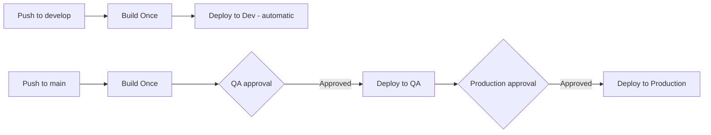
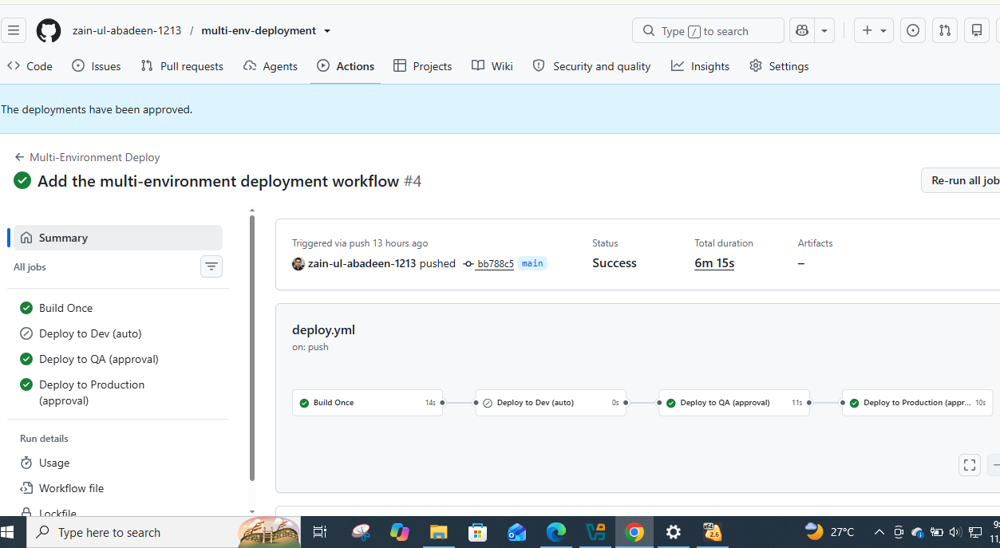
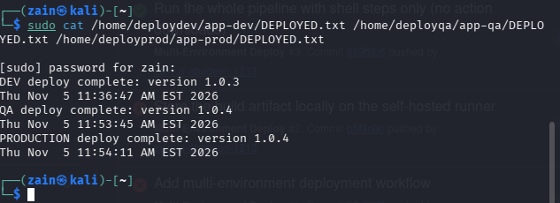

# Multi-Environment Deployment with GitHub Actions

A complete CI/CD pipeline that builds a Node.js application **once** and promotes the **same artifact** through three environments — **Dev → QA → Production** — over SSH, with **manual approval gates** protecting QA and Production.

Built and verified end-to-end on a self-hosted GitHub Actions runner.

---

## What this project demonstrates

- **Build once, deploy many** — one versioned artifact is created per run and that exact file is promoted to every environment. Nothing is rebuilt between environments, so what was tested in QA is byte-for-byte what reaches Production.
- **Environment promotion with approvals** — a push to `develop` deploys to Dev automatically. A push to `main` deploys to QA only after a human approves it, and to Production only after a second approval.
- **Per-environment isolation** — each environment is a separate Linux user account with its own SSH key, its own secrets, and its own deployment directory.
- **Secrets management** — connection details live in GitHub Environment secrets, never in the repository.
- **A pipeline that survives a slow network** — the workflow intentionally uses **no downloadable marketplace actions**. Every step is a shell step using tools provisioned on the runner itself, so a run never fails because an action download timed out.

---

## How it works



| Trigger | Build | Dev | QA | Production |
|---|---|---|---|---|
| Push to `develop` | ✅ | ✅ automatic | — | — |
| Push to `main` | ✅ | — | ✅ after approval | ✅ after second approval |
| Manual dispatch | ✅ | optional | optional | optional |

### The build

1. The code is fetched with `git` (no checkout action).
2. Node.js 20 is taken from a toolchain provisioned once on the runner (`~/node20`, installed with a resumable download and reused by every run).
3. `npm install` and `npm test` run — a failing test stops the pipeline before anything is deployed.
4. The app is packaged as `app-<version>.tar.gz`, where the version is `1.0.<run number>`.
5. The artifact is placed in a local store on the runner machine (`/tmp/artifact-store`).

### The deploys

Each deploy step connects with OpenSSH to that environment's own account (`deploydev`, `deployqa`, `deployprod`) using the key stored in that environment's secrets, extracts **the same tarball** into the environment's app folder, and writes a `DEPLOYED.txt` receipt with the version and timestamp. The private key is written to a temporary file with `600` permissions for the duration of the step and deleted immediately after.

---

## Environments and protection rules

| Environment | GitHub Environment rules | Server account | Secrets |
|---|---|---|---|
| Dev | none — deploys automatically | `deploydev` | `SERVER_HOST`, `SERVER_USER`, `SERVER_SSH_KEY` |
| QA | required reviewer approval | `deployqa` | `SERVER_HOST`, `SERVER_USER`, `SERVER_SSH_KEY` |
| Production | required reviewer approval + only the `main` branch may deploy | `deployprod` | `SERVER_HOST`, `SERVER_USER`, `SERVER_SSH_KEY` |

The three accounts live on the same Linux host as the self-hosted runner. In a cloud setup the identical design points at three separate servers — the workflow, secrets layout, and approval flow do not change.

---

## Verified results

This pipeline is not a diagram — it has been run, approved, and verified:

| Run | Branch | Result | Duration | What happened |
|---|---|---|---|---|
| [#3](https://github.com/zain-ul-abadeen-1213/multi-env-deployment/actions/runs/42065315307) | `develop` | ✅ Success | 5m 36s | Build passed (tests green), artifact created, deployed to Dev automatically |
| [#4](https://github.com/zain-ul-abadeen-1213/multi-env-deployment/actions/runs/42068183847) | `main` | ✅ Success | 6m 15s | Build in 14s, QA deploy approved and deployed in 11s, Production approved and deployed in 10s |

Deployment receipts left on the server (`DEPLOYED.txt` in each environment):

```
DEV deploy complete: version 1.0.3
QA deploy complete: version 1.0.4
PRODUCTION deploy complete: version 1.0.4
```

QA and Production carry the **identical version (1.0.4)** — the same artifact, promoted through both approvals. Dev carries 1.0.3 from the earlier `develop` run, exactly as a real promotion pipeline behaves.





---

## Engineering decisions worth noting

- **Self-hosted runner.** The deployment targets are accounts on a local machine, which GitHub-hosted runners cannot reach. A self-hosted runner on the target host is the standard solution — and a common pattern for on-premise and private-network deployments.
- **Zero marketplace actions.** Every `uses:` action is a download that must finish inside a strict time limit before the job can start. On a low-bandwidth link that made runs fail during setup, before any real work happened. Rewriting the workflow with plain shell steps (git, curl, tar, ssh — tools already on the machine) removed that failure mode entirely: job setup now takes seconds, and repeat builds complete in ~15 seconds.
- **Resumable, one-time toolchain setup.** Node.js is downloaded once with a resumable transfer and cached on the runner, instead of being fetched fresh on every run.
- **Local artifact store.** Because the runner and the targets are the same host, the artifact is promoted from a local store instead of being uploaded and re-downloaded. The build-once/promote-same-file rule is unchanged.
- **Approvals are real gates.** QA and Production deployments record an approval from a named reviewer in the run history — they cannot start without it.

---

## Repository structure

```
.
├── app.js                  # Sample Node.js application (the deployment payload)
├── test.js                 # Test suite run in the build
├── package.json
├── docs/
│   ├── main-run-success.png
│   └── deployment-verification.png
└── .github/
    └── workflows/
        └── deploy.yml      # The pipeline: build + three environment deploys
```

## Tech stack

GitHub Actions (self-hosted runner) · Node.js 20 · OpenSSH · Bash · Linux user isolation · GitHub Environments & Secrets

## Skills demonstrated

CI/CD pipeline design · GitHub Actions (jobs, needs, outputs, environments, protection rules, concurrency control) · artifact promotion strategy · SSH-based deployment · secrets management · Linux administration (users, keys, permissions) · troubleshooting distributed failures under network constraints

---

## Author

**Zain Ul Abdin** — Founder, **Zain Tech Automation Solutions** · Karachi, Pakistan
GitHub: [@zain-ul-abadeen-1213](https://github.com/zain-ul-abadeen-1213)
